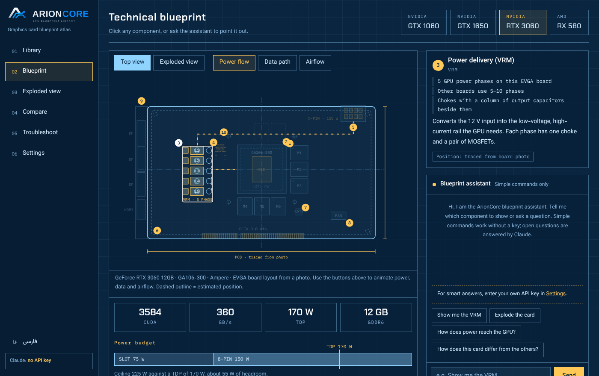
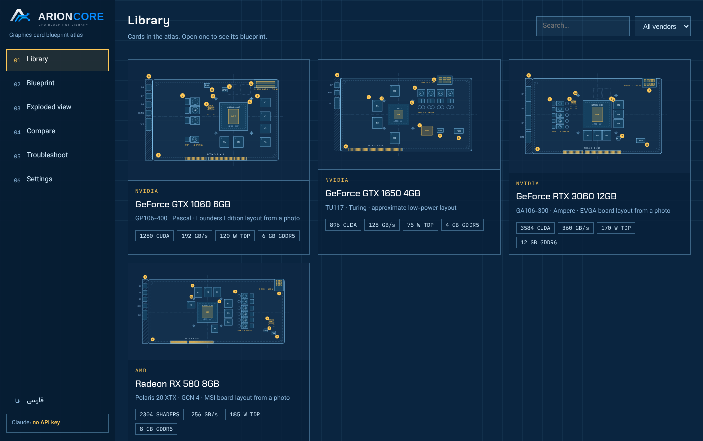
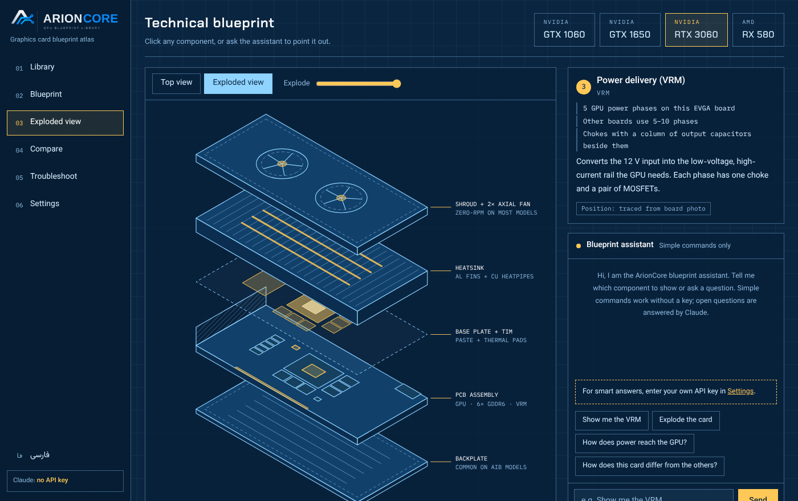
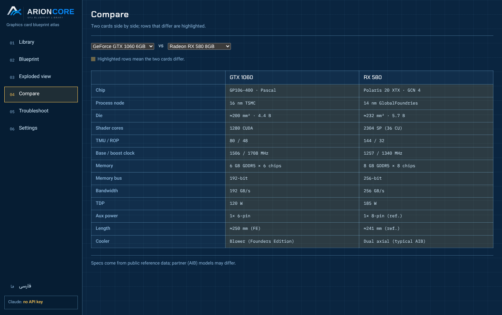
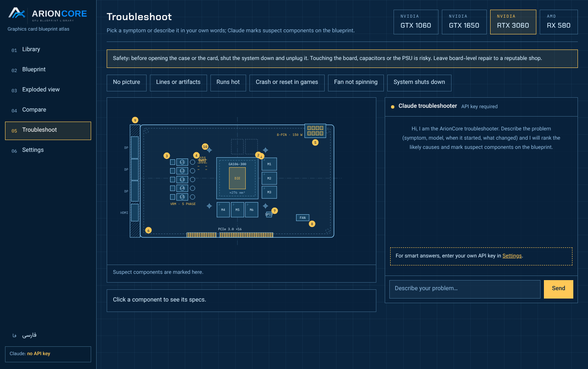
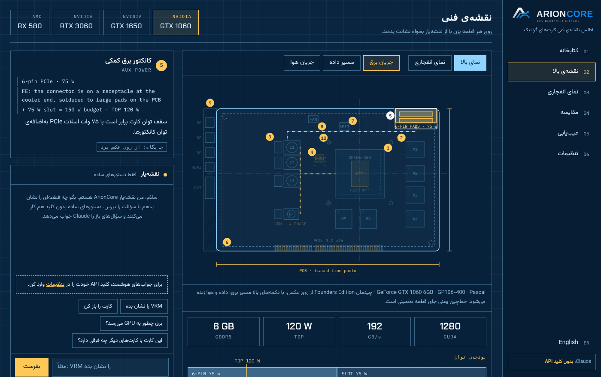

<p align="center">
  
</p>

<p align="center">
  <b>An interactive desktop atlas of graphics-card technical blueprints, with a Claude-powered assistant that explains the board and helps you troubleshoot it.</b>
</p>

<p align="center">
  
  
  
  
  
</p>

<p align="center">
  
</p>

## What it is

ArionCore turns a graphics card into something you can explore. Every card in the library is drawn as a technical blueprint: the GPU package, memory chips, power stages, connectors, and cooler layers, all clickable. Power, data and airflow can be animated on top of the board.

Next to the blueprint sits an assistant powered by the Claude API. Ask it to point at a component, explain how power reaches the GPU, compare two cards, or describe a symptom and let it rank the likely causes and mark the suspect parts on the board.

> **Status:** early prototype (0.3). The app runs, but the card library is small and some layouts are still approximate. See [Data accuracy](#data-accuracy).

## Features

- **Blueprint view.** Top view of the board with 10 component groups (GPU, VRAM, VRM, PWM controller, power connector, PCIe edge, BIOS flash, fan header, I/O, cooler mounts). Click a part for its specs and role.
- **Animated overlays.** Power flow, memory data paths and cooler airflow.
- **Exploded view.** The cooler and board as layers you can pull apart with a slider.
- **Compare.** Two cards side by side with the differing rows highlighted.
- **Troubleshoot.** Pick a symptom or describe it in your own words. Claude asks a couple of questions, ranks likely causes, suggests one cheap test for each and marks suspect components on the blueprint. Safety warnings are built into its instructions.
- **Blueprint assistant.** Simple commands ("show me the VRM", "explode the card") work offline. Open questions go to Claude.
- **English and Persian (RTL).** Switch language from the side menu; the assistant answers in the chosen language.
- **Works offline for everything except chat.** Fonts and data ship inside the app.

| Library | Exploded view |
|---|---|
|  |  |
| **Compare** | **Troubleshoot** |
|  |  |

## Cards in the library

| Card | GPU | Layout source |
|---|---|---|
| GeForce GTX 1060 6GB | GP106-400 (Pascal) | Traced from a photo of the Founders Edition board |
| GeForce GTX 1650 4GB | TU117 (Turing) | Approximate (needs a photo of the component side) |
| GeForce RTX 3060 12GB | GA106-300 (Ampere) | Traced from a photo of an EVGA board |
| Radeon RX 580 8GB | Polaris 20 XTX | Traced from a photo of an MSI board |

More cards (starting with AMD) are planned.

## Getting started

### Requirements
- Node.js 20 or newer
- Windows 10/11 for the installer. The app itself also runs on Linux and macOS with `npm start` (only Linux has been tried).

### Run from source
```bash
git clone https://github.com/<your-username>/arioncore.git
cd arioncore
npm install
npm start
```

### Build the Windows installer
On Windows, double-click `build-windows.bat`, or run:
```bash
npm run dist:win
```
The installer is written to `dist/ArionCore Setup <version>.exe`.

Notes:
- The installer is **unsigned**, so Windows SmartScreen will show a warning.
- If the build fails with a symbolic-link error, run the terminal as Administrator or turn on Windows Developer Mode.
- Building the installer on Linux needs Wine; it was not verified there.

### Run the tests
```bash
npm test
```
This runs the Claude client against a local mock server (streaming, the tool loop, error mapping and cancellation). It does not call the real API.

## Using the Claude features

The chat and the troubleshooter use the Anthropic API with **your own API key**.

1. Create a key at <https://console.anthropic.com>.
2. Open **Settings** in ArionCore, paste the key and press **Save**.
3. Press **Test connection**, then pick a model if you want a different one.

Usage is billed to your Anthropic account. Without a key, the library, blueprints, exploded view and compare pages work fully, and the blueprint assistant understands simple commands.

### Privacy and security
- The key is stored encrypted with the operating system's secure storage (Electron `safeStorage`). If that is unavailable it is kept in memory only and must be re-entered after closing the app.
- The key lives only in the main process. App pages never see it; they send chat requests over IPC and the main process calls the API.
- The window uses `contextIsolation`, a sandbox, a strict Content-Security-Policy, blocks navigation and new windows, and denies all permission requests. IPC handlers accept calls only from the app's own pages.
- The only network traffic is chat requests to `api.anthropic.com`, and only when you use the assistant.

## How it works

```
main.js        Electron main process: window, settings, encrypted key, IPC
preload.js     Narrow, safe bridge exposed to the pages as window.api
claude.js      Streaming Anthropic Messages client with a tool-use loop (no Electron imports)
renderer/
  index.html   App shell with a Content-Security-Policy
  app.js       Menu, pages, assistant tools and local command parser
  chat.js      Chat panel (history per mode, streaming, errors)
  draw.js      SVG renderers: top view, exploded view, animated flows
  data.js      Card library: specs, parts, layers
  geom.js      Board geometry traced from photos, merged over data.js
  i18n.js      English/Persian texts and accessors
brand/         Logo and icon files
build/         Icons used by the installer
test/          Claude client test with a mock SSE server
```

The assistant works through tools that run inside the app (`highlight_part`, `set_view`, `toggle_flow`, `select_card`, and `mark_suspects` in the troubleshooter). Claude sees the selected card's data in its system prompt and answers only from that data.

## Adding a card

Cards are plain data. To add one:

1. Add a block to `A.CARDS` in `renderer/data.js` (name, stats, `cmp` rows, part specs, cooler layers) and add its id to `A.CARD_ORDER`.
2. Add its English chip line to `CHIP` in `renderer/i18n.js`.
3. Optionally add a block to `renderer/geom.js` with positions traced from a board photo. Coordinates are in board space (board height 380 units). Memory chips are `[x, y, w, h]`, VRM phases can be laid out vertically with `rows`, and `conf` marks each part as `photo` (traced) or `est` (estimated, drawn dashed).

The drawing code builds the blueprint, the exploded view and the info panels from that data.

## Data accuracy

- Specs (shader counts, memory, bus, TDP and so on) are public reference values.
- Board layouts for the GTX 1060, RTX 3060 and RX 580 were traced by eye from reference photos of real boards, to roughly a few percent. They are accurate for **those specific boards**; other models of the same card differ (phase count, connectors, memory placement).
- Parts whose position could not be identified (PWM controller, BIOS chip, some outputs) are estimated and drawn with a dashed outline.
- The GTX 1650 layout is approximate.
- Always check a number against the manufacturer datasheet before relying on it. Troubleshooting suggestions are a first guide, not a hands-on diagnosis. Board-level repair is best left to a reputable repair shop.

The photos used for tracing are not included in this repository.

## Roadmap

- [ ] Layout for the GTX 1650 from a component-side photo
- [ ] More cards, starting with AMD (for example RX 6600 and RX 5700 XT)
- [ ] Per-value sources and a "verified" badge for specs
- [ ] "Report a mistake" button inside the app
- [ ] Voice assistant
- [ ] Code-signed installer and auto-update
- [ ] Linux and macOS packages

## Contributing

Issues and pull requests are welcome, especially corrections to specs or layouts. When you report a data mistake, please include the exact board model and a source (datasheet, review, or your own photo). Please do not attach photos you do not have the right to share.

## Brand

Logo and icon files are in [`brand/`](brand). The logo is made for dark backgrounds.

| Role | Hex |
|---|---|
| Electric cyan | `#00C8FF` |
| Blue | `#0797FF` |
| Deep blue | `#075BFF` |
| Silver | `#AEBDCE` |
| Ice | `#E8EEF5` |
| Night | `#07111D` |

ARION is the mythical swift horse; CORE is the GPU core.

## Disclaimer

ArionCore is an independent project by **Arion**. NVIDIA, GeForce, AMD, Radeon, EVGA, MSI and other names are trademarks of their respective owners and are used only to identify the products shown. ArionCore is not affiliated with or endorsed by them or by Anthropic. "Claude" is a product of Anthropic.

## License

Not yet chosen. The `package.json` currently says `UNLICENSED` (all rights reserved). Add a `LICENSE` file and update `package.json` before inviting contributions.

---

<details dir="rtl">
<summary><b>خلاصه به فارسی</b></summary>

<div dir="rtl">

**ArionCore** یک اطلس دسکتاپ و تعاملی از نقشه‌های فنی کارت‌های گرافیک است. هر کارت به‌صورت بلوپرینت کشیده شده و می‌توانی روی هر قطعه (GPU، حافظه، VRM، کانکتور برق و غیره) بزنی و مشخصاتش را ببینی. جریان برق، مسیر داده و جریان هوا هم قابل نمایش است.

کنار نقشه یک دستیار با API شرکت Anthropic (Claude) هست. می‌توانی از او بخواهی قطعه‌ای را نشان بدهد، دو کارت را مقایسه کند، یا علامت خرابی کارتت را بگویی تا علت‌های محتمل را رتبه‌بندی کند و قطعات مشکوک را روی نقشه علامت بزند.

<p align="center"></p>

**ویژگی‌ها:** نمای بالا، نمای انفجاری (لایه‌های کولر)، مقایسه‌ی دو کارت، عیب‌یابی، رابط فارسی (راست‌به‌چپ) و انگلیسی.

**اجرا:** Node.js 20 به بالا را نصب کن، بعد `npm install` و `npm start`. برای ساخت نصب‌کننده‌ی ویندوز فایل `build-windows.bat` را اجرا کن. نصب‌کننده امضای دیجیتال ندارد و ویندوز هشدار SmartScreen می‌دهد.

**چت و عیب‌یاب:** از بخش «تنظیمات» کلید API خودت را وارد کن (از console.anthropic.com). کلید با رمزنگاری سیستم‌عامل ذخیره می‌شود و هزینه‌ی مصرف روی حساب خودت است. بدون کلید، همه‌ی صفحه‌ها به‌جز چت هوشمند کار می‌کنند.

**دقت داده‌ها:** مشخصات عددی مرجع هستند. چیدمان قطعات برای GTX 1060 (Founders Edition)، RTX 3060 (EVGA) و RX 580 (MSI) از روی عکس همان بردها ردیابی شده و فقط برای همان مدل‌ها درست است. قطعه‌هایی که جایشان تخمینی است با خط‌چین کشیده می‌شوند. چیدمان GTX 1650 هنوز تقریبی است. قبل از اتکا به هر عدد، آن را با دیتاشیت سازنده چک کن.

</div>

</details>
